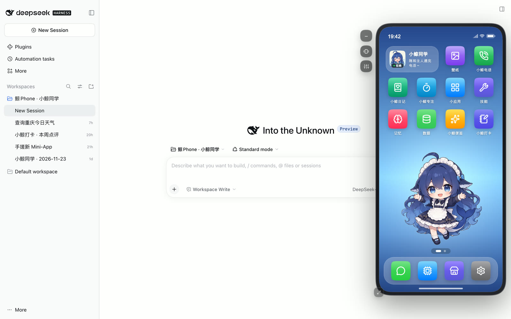

# dsh-plugin-jphone — 小鲸同学 (JingChan / JPhone)

> **小鲸同学 (JingChan)** 是基于 [DeepSeek Harness (DSH)](https://github.com/deepseek-ai/deepseek-harness) 的 AI 伴侣桌面插件：桌面 Q 版桌宠、免提实时语音通话、沉浸式「小鲸专注」伴学工作台（内置 12 路离线白噪音 + 6 首 Lo-Fi，支持导入自定义动态视频）、Panime 动态壁纸（[panime.ft07.com](https://panime.ft07.com/)）、AI 日记、去中心化 Git 创意工坊，以及安卓手机端远程配对。



## 安装方式

在你的 DeepSeek Harness 中安装本插件：

```bash
# 从 npm 一行安装（推荐）
dsh plugin add dsh-plugin-jphone

# 或从本地克隆路径安装
git clone https://github.com/easychen/jing-chan-os.git
dsh plugin add ./jing-chan-os/packages/dsh-plugin-jphone
```

安装并启用后，DSH 侧边栏与桌面右下角将自动出现 **小鲸同学**：
- **桌面端 Web 控制台**：点击右下角小鲸或侧边栏图标打开悬浮虚拟手机与控制台
- **安卓手机端配对**：从 [GitHub Releases](https://github.com/easychen/jing-chan-os/releases/latest) 下载 `小鲸同学` APK，打开「设置 → 扫码配对连接」，扫描控制台二维码即可（支持局域网直连与一键 Cloudflare 公网穿透）

## 开发与测试

```bash
node --test tests/*.test.mjs
```

## 开源协议

- 插件服务端源码、桥接协议、内置 Mini-App 模板与 Skills 采用 **MIT License**。
- 预编译的 `web-dist/` 静态资源与 GitHub Releases 发布的 Android APK 免费供个人使用与分发，详情请参阅 [LICENSE](https://github.com/easychen/jing-chan-os/blob/main/LICENSE)。
