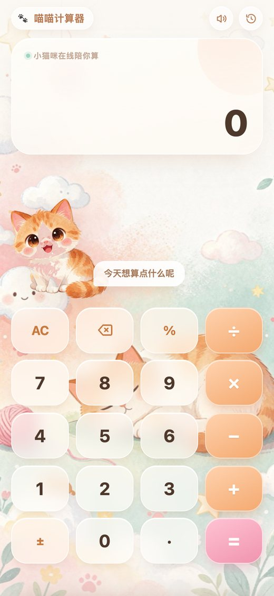

# 喵喵计算器 · meow-calc

> 猫猫陪伴的治愈系计算器 —— 头顶毛线球，脚踩睡猫，算数也能很温柔。



## 功能

- **实时算式预览**：上方一行算式、下方大字结果，边输入边出答案（`0.1 + 0.2` 会乖乖显示 `0.3`）。
- **完整四则运算**：`+ − × ÷ %`、正负号、退格、AC 清除，带千分位大数、超大数自动科学计数法。
- **小猫互动**：点一下小猫会喵一声、摇尾巴、冒爱心，并换一句台词；输入除以 0 时小猫会被吓到，显示「喵？」。
- **毛线球账本**：每次按 `=` 自动记录，滑出面板以「刚刚 / 5 分钟前」展示历史，点历史条目可取回结果继续算。
- **喵喵音效**：数字 / 运算符 / 等号各有专属轻音色，右上角一键静音（偏好会被记住）。
- **体验细节**：爪印涟漪按压反馈、长按 `AC` 或 `⌫` 一键全清、触感振动、顶栏与奶油猫猫背景无缝同色。

## 技术说明

- 单文件 HTML5 应用（内联 CSS/JS），无任何 CDN 或外部请求，断网可完整运行。
- 背景插画与 Q 版橘猫贴纸由 **Seedream 5.5** 生成，并以 base64 内联，保证单文件分发。
- 顶栏配色通过 `<meta name="jphone-header-bg">` 与 `window.jing.ui.setHeaderStyle(...)` 同步，`color-scheme: light` 匹配明暗状态栏。
- 历史账本与音效偏好使用 `window.jing.db.get / set` 持久化（私有 KV 命名空间）。
- 计算引擎基于 token 序列而非字符串拼接，负号、百分号、乘除优先级均有明确语义。

## 权限

| 权限 | 用途 |
| --- | --- |
| `storage` | 保存毛线球账本与音效开关 |
| `ui.header` | 让原生顶栏与本应用背景无缝同色 |

## 安装

在小鲸同学「创意工坊 → Git 链接安装」中粘贴：

```
https://github.com/easychen/jing-chan-os/tree/main/workshop/packages/meow-calc
```

或者在创意工坊首页「官方精选」里直接点「喵喵计算器」。

## License

MIT
